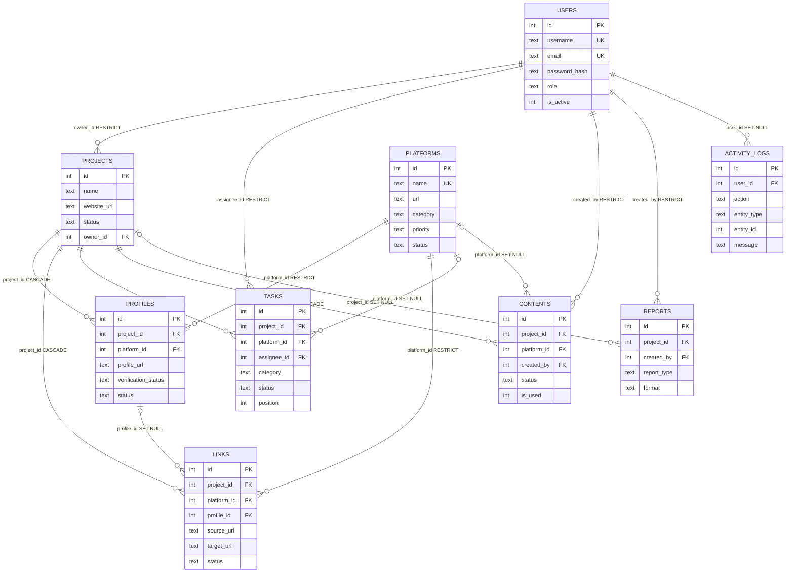

# LINKHUB — Sơ đồ ERD

Nguồn dữ liệu chuẩn là [`server/src/schema.sql`](../server/src/schema.sql).

## Quan hệ và hành vi xóa

- Dự án là gốc của hồ sơ, liên kết, nhiệm vụ và nội dung. Xóa dự án sẽ xóa dây chuyền các bản ghi con (`CASCADE`); báo cáo đã xuất được giữ lại với `project_id = NULL`.
- Nền tảng là danh mục dùng chung. Không thể xóa nền tảng đang được hồ sơ hoặc liên kết tham chiếu (`RESTRICT`); tác vụ và nội dung chỉ bỏ tham chiếu (`SET NULL`).
- Mỗi dự án có tối đa một hồ sơ cho mỗi nền tảng nhờ `UNIQUE(project_id, platform_id)`.
- Liên kết có thể gắn hồ sơ; khi xóa hồ sơ, liên kết vẫn còn và `profile_id` thành `NULL`. Ứng dụng còn kiểm tra hồ sơ và liên kết phải cùng dự án/nền tảng.
- Người dùng được tham chiếu bởi dự án, nhiệm vụ, nội dung, báo cáo và nhật ký. Các quan hệ nghiệp vụ dùng `RESTRICT`; nhật ký giữ lại khi người dùng bị xóa bằng `SET NULL`.

## Ràng buộc và chuẩn hóa

- `PRAGMA foreign_keys = ON` được bật khi mở database; các trạng thái, vai trò, loại và cờ boolean được ràng buộc bằng `CHECK`.
- Tên đăng nhập, email, tên nền tảng và cặp dự án/nền tảng của hồ sơ có ràng buộc `UNIQUE`.
- Bảng danh mục và bảng dữ liệu theo dự án được tách riêng; tên hiển thị và số liệu được truy vấn từ dữ liệu gốc thay vì lưu bản tổng hợp.
- `platforms.link_types` là chuỗi danh sách ngắn phân tách bằng dấu phẩy để giao diện hiển thị; đây là lựa chọn đơn giản hóa có chủ đích cho bản demo.
